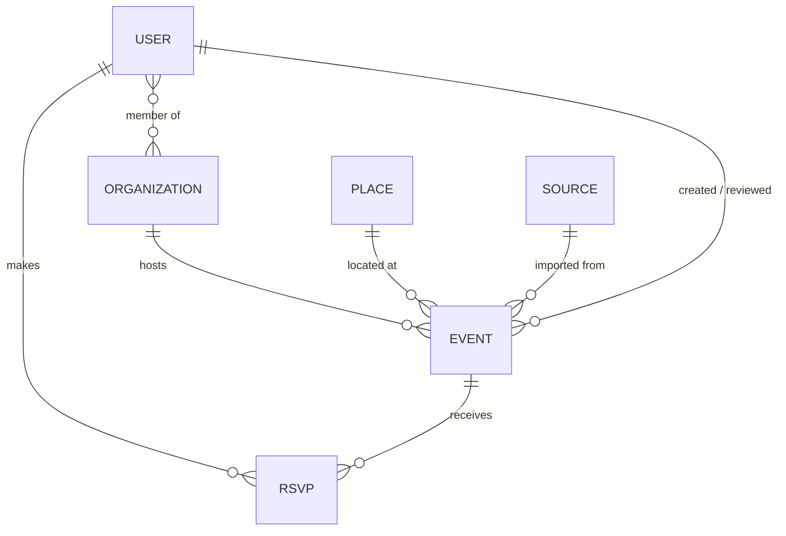
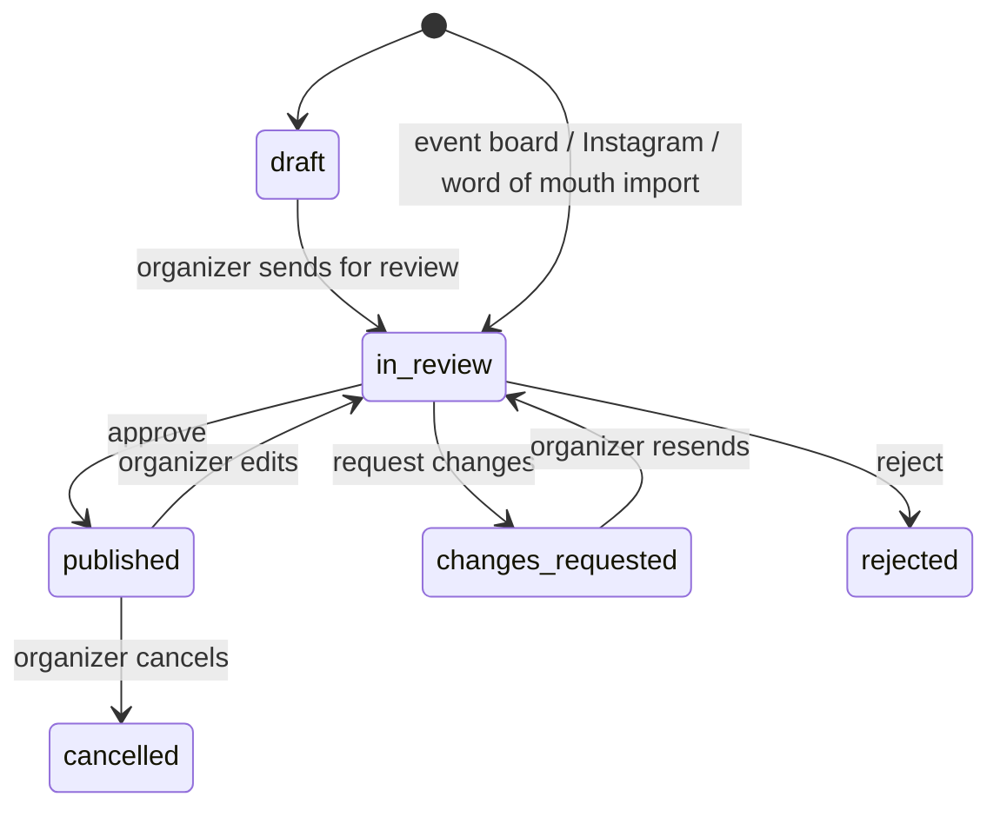

# Database schema (MongoDB)

The Mongoose models live in [`api/src/models/`](../api/src/models). This document explains what each collection holds, why it's shaped that way, and how the screens in the [design mock](../mock/illi-knows-ikd.html) read and write it.

Six collections:



| Collection | Model | One document is |
|---|---|---|
| `users` | `User` | A person who signed in (student, organizer, admin, or several) |
| `organizations` | `Organization` | A club, department, or office that hosts events |
| `places` | `Place` | A campus building or open space drawn on the SVG map |
| `sources` | `Source` | One feed listings come from: an event board, an Instagram account, or the manual word-of-mouth queue |
| `events` | `Event` | One event, from draft through review to published |
| `rsvps` | `Rsvp` | One user's relationship to one event: going, anonymous, calendar, reminder, check-in |

All dates are stored as UTC `Date`s. The app shows them in `America/Chicago`.

Shared enums (categories, statuses, reminder options, and so on) are in [`shared/src/constants.ts`](../shared/src/constants.ts), so the API and the frontend use the same values.

---

## users

| Field | Type | Notes |
|---|---|---|
| `name` | String, required | Shown on the attendee list unless the RSVP is anonymous |
| `email` | String, required, unique | Lowercased campus email |
| `firebaseUid` | String, unique when set | Firebase Authentication user ID. Set on first sign-in; accounts created ahead of time (for example with `npm run grant-role`) are linked by email |
| `roles` | [`student` \| `organizer` \| `admin`] | At least one role. Decides which pages a user sees |
| `preferences.defaultReminder` | `none` \| `1h` \| `1d` \| `1w` | Pre-fills "Remind me" |
| `preferences.rsvpAnonymously` | Boolean | Pre-selects anonymous RSVP |
| `preferences.emailReminders` | Boolean | |
| `lastLoginAt`, `createdAt`, `updatedAt` | Date | |

Guests have no document. Browsing never writes to the database except the event `viewCount`.

## organizations

| Field | Type | Notes |
|---|---|---|
| `name` | String, required | "Campus Radio" |
| `slug` | String, unique | `campus-radio` |
| `kind` | `club` \| `department` \| `office` \| `other` | |
| `instagramHandle` | String | Lets imported Instagram posts link to the right host |
| `members` | [{ `user`, `role`: `owner` \| `editor` }] | Who can manage this organization's events. Embedded because the list stays small |
| `verified` | Boolean | Set by an admin |

## places

Real campus buildings and open spaces, imported from OpenStreetMap by `npm run campus:import -w @illi-knows/api`. The same script writes the base map the website draws (`web/public/map/campus-basemap.json`: streets, paths, water, green space, and every building outline). The map shows "© OpenStreetMap contributors", which the OpenStreetMap license requires.

| Field | Type | Notes |
|---|---|---|
| `key` | String, unique | Slug of the name: `illini-union`, `main-quad`, `activities-and-recreation-center` |
| `name` | String | "Illini Union" |
| `aliases` | [String] | Lowercased names that map typed or imported locations to this place: `union`, `student union`, `the arc`, `ugl`. Includes OpenStreetMap's alternate names plus a short manual list |
| `kind` | `building` \| `residence` \| `library` \| `venue` \| `recreation` \| `quad` \| `green` \| `field` | Changes how the map styles it |
| `osmId` | String, unique when set | `way/123456`, so re-running the import updates places instead of duplicating them |
| `facilityNumber` | String, optional | The university's building number, when OpenStreetMap has it |
| `geo` | GeoJSON Point, required, 2dsphere index | Where the pin goes: the outline's center |
| `outline` | GeoJSON Polygon | The building's real shape, simplified to about a meter |
| `address` | String, optional | |

The website projects `[longitude, latitude]` onto the SVG map with `project()` in [`shared/src/campus.ts`](../shared/src/campus.ts). When a listing's location doesn't match any place's aliases, `location.place` stays empty and the event shows under "Not on the map."

## sources

These back the three status cards at the top of the admin review queue.

| Field | Type | Notes |
|---|---|---|
| `kind` | `event_board` \| `instagram` \| `word_of_mouth` | |
| `name` | String | "Campus events calendar", "@acousticclub" |
| `url`, `handle` | String | `handle` is unique per kind |
| `organization` | ObjectId → Organization | Optional |
| `mode` | `automatic` \| `manual` | Event boards sync on a timer. Instagram is imported by hand |
| `syncEveryMinutes` | Number | 30 for event boards |
| `active` | Boolean | |
| `lastRun.at`, `lastRun.newListings`, `lastRun.error` | | "Last sync 12 minutes ago, 2 new listings" |

## events

| Field | Type | Notes |
|---|---|---|
| `title` | String, required, max 120 | |
| `description` | String, max 5000 | |
| `category` | `Music` \| `Food` \| `Sports` \| `Career` \| `Arts` | |
| `startsAt`, `endsAt` | Date, required | `endsAt` must be after `startsAt`. "Past" comes from `endsAt` and isn't stored |
| `location.place` | ObjectId → Place | Empty means the event isn't on the map |
| `location.detail` | String | "courtyard stage", "room 204" |
| `location.text` | String | Location as typed or imported, kept for search and review |
| `host.organization` | ObjectId → Organization | Optional. Imported listings may not match an organization yet |
| `host.name` | String, required | Copy of the host's name, so lists don't need a lookup |
| `createdBy` | ObjectId → User | The organizer, or the admin who entered a word-of-mouth tip |
| `price.isFree`, `price.amountCents`, `price.note` | | `$8` is stored as `800`. Note example: "Pay at the door" |
| `source.kind` | `organizer` \| `event_board` \| `instagram` \| `word_of_mouth` | Drives the "Found on" filter |
| `source.feed` | ObjectId → Source | |
| `source.handle`, `source.url`, `source.externalId` | String | `externalId` is unique per kind, so a re-sync can't create duplicates |
| `status` | `draft` \| `in_review` \| `changes_requested` \| `published` \| `rejected` \| `cancelled` | Only `published` events are public |
| `publishedAt` | Date | |
| `review.flags` | [{ `code`, `message`, `relatedEvent` }] | Automatic checks shown as "Check: …" in the queue |
| `review.note` | String | Latest note to the organizer ("Add a location") |
| `review.history` | [{ `decision`, `by`, `note`, `at` }] | Audit trail. Stays short, so it's embedded |
| `stats.goingCount`, `stats.anonymousCount`, `stats.checkInCount`, `stats.viewCount` | Number | Running totals kept on the event so lists and cards don't need to count RSVPs |

Virtuals: `isPast` and `isOnMap`.

Flag codes: `location_missing`, `possible_duplicate` (with `relatedEvent`), `not_an_event`, `date_from_image`, `other`.

### Status flow



Every move appends to `review.history`. As in the mock, editing a published event sends it back to `in_review`.

## rsvps

One document per user per event, created the first time a signed-in user RSVPs, adds the event to their calendar, or sets a reminder.

| Field | Type | Notes |
|---|---|---|
| `user` | ObjectId → User, required | |
| `event` | ObjectId → Event, required | `(user, event)` is unique |
| `going` | Boolean | `false` after "Cancel RSVP", or when only calendar or reminder was used |
| `anonymous` | Boolean | "RSVP anonymously" / "Keep my RSVP anonymous" |
| `inCalendar` | Boolean | "Add to calendar" |
| `reminder` | `none` \| `1h` \| `1d` \| `1w` | "Remind me" |
| `remindAt` | Date | `event.startsAt` minus the reminder. Cleared once the reminder is sent |
| `reminderSentAt` | Date | |
| `foundVia` | `instagram` \| `event_board` \| `friends` \| `search` \| `map` \| `other` | Feeds "How people found this event" |
| `checkedInAt` | Date | Set at the door. Feeds check-ins and show-up rate |
| `cancelledAt` | Date | |

### Anonymous RSVP rules

- An anonymous RSVP still counts in `stats.goingCount`. It also adds to `stats.anonymousCount`.
- The public attendee list only reads `{ event, going: true, anonymous: false }`.
- Organizers get counts for anonymous RSVPs, never the users behind them. The API must not send `user` for anonymous RSVPs to anyone but that user.
- The user always sees their own RSVP in their planner, marked "Going anonymously."

---

## How the screens use it

| Screen | Query |
|---|---|
| Landing, "This week around campus" | `events.find({ status: 'published', startsAt: { $gte: now, $lt: endOfWeek } }).sort({ startsAt: 1 })`, then the places in those results |
| Discover filters | Same base query plus `category`, `source.kind`, `price.isFree: true`, and `$text: { $search: q }` |
| Discover Map tab | Same results grouped by `location.place`. Events without a place go in the "Not on the map" list |
| Week view | Base query with `startsAt` inside the shown week |
| Event page attendees | `rsvps.find({ event, going: true, anonymous: false }).populate('user', 'name')` with a limit. Total from `stats.goingCount` |
| Event page "Also on Friday" | Published events on the same calendar day |
| My planner | `rsvps.find({ user, going: true }).populate('event')`, keep upcoming events, sort by `event.startsAt` |
| Planner "Your route" | Planner events, in date order, joined to `places` |
| Manage events | `events.find({ 'host.organization': { $in: myOrgIds } }).sort({ startsAt: -1 })` |
| Organizer map | Same list without past events, grouped by `location.place` |
| Insights, RSVPs over time | Aggregate `rsvps` for the event by day of `createdAt` over the 14 days before `startsAt` |
| Insights, how people found it | Aggregate `rsvps` for the event, `$group` by `foundVia` |
| Insights, past events | Past events of the organization with `stats.goingCount` and `stats.checkInCount` |
| Review queue tabs | Pending is `status: 'in_review'`. Changes requested and Rejected match their statuses. Approved is `status: 'published'` with a recent `approved` entry in `review.history` |
| Review source cards | `sources.find({ active: true })` |
| Reminder job | `rsvps.find({ remindAt: { $lte: now } })`. Send, set `reminderSentAt`, unset `remindAt` |

### Keeping the totals right

- **RSVP, cancel, and anonymous changes** update the `rsvps` document and `$inc` the matching `events.stats` fields together. Use a transaction, or a single `findOneAndUpdate` on the RSVP followed by `$inc` on the event. A nightly job can recount from `rsvps` to fix any drift.
- **Event time changes** must recompute `remindAt` on every RSVP with a reminder.
- **Viewing an event page** does `$inc: { 'stats.viewCount': 1 }`.

## Indexes

| Collection | Index | Serves |
|---|---|---|
| users | `email` unique, `firebaseUid` unique when set | Sign-in |
| organizations | `slug` unique, `members.user` | "Which organizations can I manage?" |
| places | `key` unique, `aliases`, `geo` 2dsphere, `osmId` unique when set | Location matching, nearby queries, re-imports |
| sources | `(kind, handle)` unique when handle is set, `(kind, active)` | Imports, admin cards |
| events | `(status, startsAt)` | Landing, Discover, Week |
| events | `(status, category, startsAt)` | Category filter |
| events | `(status, source.kind, startsAt)` | "Found on" filter |
| events | `(location.place, startsAt)` | Map, "Also at this place" |
| events | `(host.organization, startsAt desc)`, `(createdBy, startsAt desc)` | Manage events |
| events | `(source.kind, source.externalId)` unique when `externalId` is set | Prevents duplicate imports |
| events | Text index on `title` (weight 10), `host.name` (5), `location.text` (3), `description` (1) | Search box |
| rsvps | `(user, event)` unique | One RSVP per person per event |
| rsvps | `(event, going, anonymous)` | Attendee list, counts, insights |
| rsvps | `(user, going)` | Planner |
| rsvps | `remindAt`, only where set | Reminder job |

## Example documents

```json
{
  "_id": { "$oid": "6738a1f0c2e4b5a1d0000012" },
  "title": "Battle of the bands",
  "description": "Six student bands, twenty minutes each, and the crowd picks the winner.",
  "category": "Music",
  "startsAt": { "$date": "2026-11-22T01:30:00Z" },
  "endsAt": { "$date": "2026-11-22T04:30:00Z" },
  "location": { "place": { "$oid": "6738a1f0c2e4b5a1d0000101" }, "detail": "Ballroom", "text": "Student union ballroom" },
  "host": { "organization": { "$oid": "6738a1f0c2e4b5a1d0000201" }, "name": "Campus Radio" },
  "createdBy": { "$oid": "6738a1f0c2e4b5a1d0000302" },
  "price": { "isFree": false, "amountCents": 800, "note": "Pay at the door" },
  "source": { "kind": "instagram", "handle": "@campusradio" },
  "status": "published",
  "publishedAt": { "$date": "2026-11-05T15:00:00Z" },
  "review": {
    "flags": [],
    "history": [
      { "decision": "submitted", "by": { "$oid": "6738a1f0c2e4b5a1d0000302" }, "at": { "$date": "2026-11-04T18:00:00Z" } },
      { "decision": "approved", "by": { "$oid": "6738a1f0c2e4b5a1d0000303" }, "at": { "$date": "2026-11-05T15:00:00Z" } }
    ]
  },
  "stats": { "goingCount": 188, "anonymousCount": 12, "checkInCount": 0, "viewCount": 1240 }
}
```

```json
{
  "user": { "$oid": "6738a1f0c2e4b5a1d0000301" },
  "event": { "$oid": "6738a1f0c2e4b5a1d0000009" },
  "going": true,
  "anonymous": true,
  "inCalendar": false,
  "reminder": "none",
  "foundVia": "instagram"
}
```
